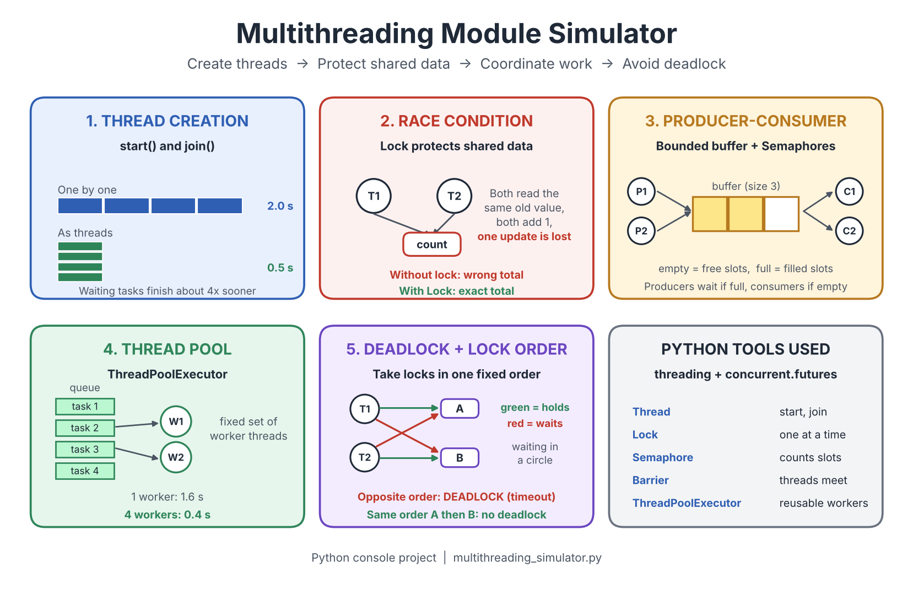

# Project-OS

## Operating System Modules Simulator

Project-OS is an educational project developed to understand important Operating System concepts through Python programs and graphical simulations.

## Modules

### 1. Disk Scheduling
Implements FCFS, SSTF, SCAN, and C-SCAN disk scheduling algorithms.

### 2. Multithreading Simulator
Demonstrates how multiple threads execute and share system resources.

### 3. Process Synchronization
Explains synchronization between processes and threads.

### 4. Resource Allocation
Demonstrates resource allocation and related Operating System concepts.

## Technologies Used

- Python 3
- Operating System concepts
- Graphical User Interface (GUI), where implemented

## Project Files

| File | Description |
|---|---|
| `disk_scheduling.py` | Disk scheduling algorithms |
| `multithreading_simulator.py` | Multithreading simulation |
| `process_synchronization.py` | Process synchronization |
| `resource_allocation.py` | Resource allocation simulation |
| `multithreading_diagram.png` | Multithreading diagram |

## How to Run

1. Install Python 3.
2. Download or clone this repository.
3. Open CMD inside the project folder.
4. Run a module:

```bash
python disk_scheduling.py
```

Other modules can be started using their respective filenames.

## Multithreading Diagram



## Project Objective

To learn and demonstrate fundamental Operating System concepts through practical programming and simulation.

## Author

BS Computer Science Project
